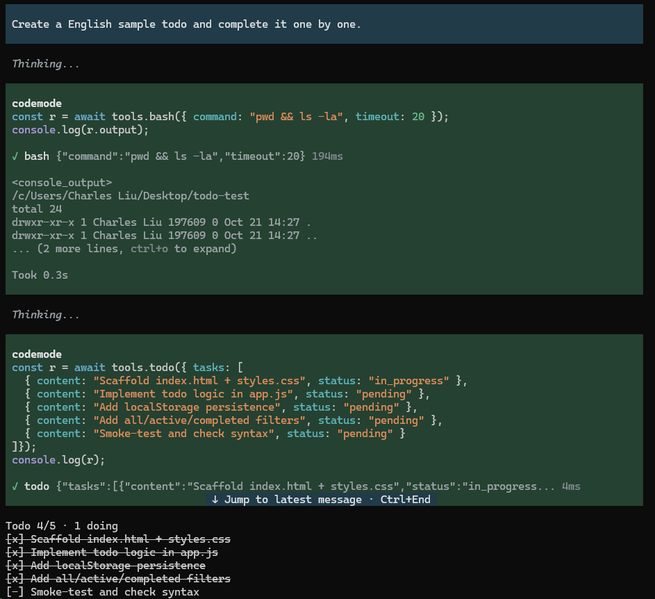

# pi-todo-lite

[English](README.en.md) | 简体中文



pi 的 todo 扩展：模型维护一张有序的 Todo 表，输入框上方常驻显示；compaction、切分支、`--continue` 之后照旧回放。四个源文件、零运行时依赖。

## 安装

```bash
pi install npm:pi-todo-lite
```

跟 GitHub 默认分支走（想尝鲜或者要改代码）：

```bash
pi install git:github.com/setwhite/pi-todo-lite   # 写进 ~/.pi/agent/settings.json
pi -e git:github.com/setwhite/pi-todo-lite        # 只试一次，不落 settings
```

## 用法

- 模型侧只有一个工具 `todo(tasks)`：一次调用交完整张表、整表替换，`tasks: []` 表示清空。
- 表在输入框上方，默认最多 9 行（溢出先丢已完成的）；`alt+t` 折叠它，任务表一寸不动。
- 整表做完后它留在屏幕上，直到你发下一条消息才消失（`lifecycle.onFinish` 可换）。
- `/todos` 全列清单；`/todos clear` 清空；`/todos export` 导出 markdown；`/todos import <file>` 读回（表非空时先 clear）。

## 配置

`<agent dir>/pi-todo/config.json`：`<agent dir>` 先看 `$PI_CODING_AGENT_DIR`，没设就是 `~/.pi/agent`。扩展**只读不写**，没有这个文件就是全默认值；JSON 坏、键名不认识、类型或枚举错会直接抛错（消息带绝对路径与逐条 `字段路径: 原因`），数值越界自动夹到上下限。

零配置就能用。要改就只写要改的键：

```json
{ "ui": { "widget": { "maxLines": 5 } } }
```

全部键，值即默认值（`//` 只是注释，真配的时候删掉）：

```jsonc
{
  "tools": { "todo": { "name": "todo" } },           // 工具名
  "plan": {
    "maxTasks": 20,                                  // 表里最多几条，超了这次调用失败
    "maxSubjectChars": 120,                          // 每条内容最长多少字符
    "requireSingleInProgress": false                 // true = 只准一条 in_progress
  },
  "ui": {
    "widget": {
      "enabled": true,                               // 显不显示这块
      "maxLines": 9,                                 // 最多几行（3–10）
      "placement": "aboveEditor",                    // aboveEditor / belowEditor
      "showCompleted": true,                         // 已完成的逐条列出
      "header": "Todo {done}/{total} · {doing} doing", // 表头模板，占位符 {done} {total} {doing}
      "glyphs": { "pending": "[ ]", "inProgress": "[-]", "completed": "[x]" }, // 三种状态的字形
      "completedStyle": "strikethrough"              // strikethrough / dim / plain
    },
    "shortcut": { "toggle": "alt+t" }                // 折叠键；off = 不注册
  },
  "lifecycle": { "onFinish": "clear" },              // model / keep / clear
  "commands": {
    "todos": { "enabled": true },                    // /todos
    "export": {
      "enabled": true,                               // /todos export
      "dir": "",                                     // 导出目录，空 = 项目根
      "fileNamePattern": "todo-{timestamp}.md"       // 文件名模板，同名让位不覆盖
    },
    "import": { "enabled": true }                    // /todos import <file>
  },
  "guidance": {                                      // 给模型看的文案，整组替换
    "description": "…",                              // 工具描述
    "promptSnippet": "",                             // 工具清单那行，空 = 不出现
    "promptGuidelines": ["…"]                        // guidelines
  }
}
```

未知键直接抛错（见上），不会静默忽略。`pnpm test` 有一条对账：这份示例必须跟代码里的默认值逐字一致。

## 开发

```bash
pnpm install
pnpm lint                          # biome check：lint + 格式化检查（`--write` 落盘）
pnpm check:imports                 # 依赖方向闸：docs/SPEC.md「模块」一节的机读版
pnpm typecheck                     # tsc --noEmit
pnpm test                          # vitest
pi -ne -e ./src/index.ts           # 从工作区直接跑，不进 settings
```

源码全在 `src/`（入口 `src/index.ts`），测试在 `test/`，仓库根只放配置与文档。CI 跑上面 lint / `check:imports` / typecheck / test 四条。

提交前闸（可选，仓库内生效）：`git config core.hooksPath .githooks`，之后每次提交跑同样四条，约 3 秒。

发版：改 `package.json` 的 `version` 与 `CHANGELOG.md`，推送 `main` 即由 `.github/workflows/npm-publish.yml` 发布（registry 上已有该版本则跳过）。

## 文档

| 文档 | 什么时候看 |
|---|---|
| [`docs/SPEC.md`](docs/SPEC.md) | 唯一契约：问题、用户故事、工具协议、界面、验收标准（AC）、不做的、术语。要改协议先改它 |
| [`docs/DECISIONS.md`](docs/DECISIONS.md) | 想推翻某个设计（整表协议、状态载体、nudge、配置读取、自动清空）之前，先看当初为什么这么定 |
| [`CHANGELOG.md`](CHANGELOG.md) | 每个已发布版本的用户可见变更；升级前看这里 |

文档只留代码里读不出的东西：签名、导出、逐条行为看源码。

## License

MIT © setwhite
